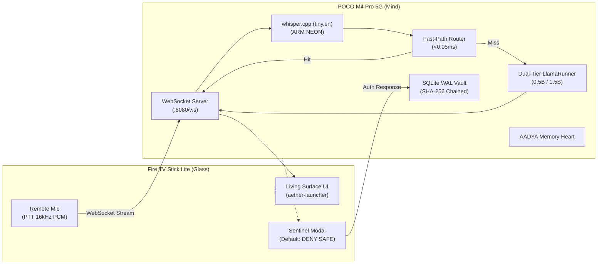

# ÆONIX PRISM // Sovereign Intelligence & Living-Room OS
**POCO M4 Pro 5G Core Mind + Fire TV Stick Lite Glass Terminal**
**Author:** Aditya (User: Aadi) | **Architecture:** Local-First, Zero-Cloud, Sovereign Distributed Intelligence

---

## 1. System Vision & Architecture

ÆONIX PRISM is a two-device, zero-cost, privacy-first sovereign intelligence operating system designed from the **Complete A–Z Master Document** and **Master Coding Guidelines v2.0**:

- **Device 1: POCO M4 Pro 5G (Dimensity 810, Android Termux, `10.116.23.168`)**
  - **The Mind & Vault**: Houses the local LLM inference engines, persistent memory heart, cryptographic hash-chained audit vault, Zeroconf mDNS broadcaster, and asynchronous ASGI daemon.
  - **100% Offline & Free**: Operates using quantized local models (`Qwen2.5-0.5B` & `Qwen2.5-1.5B`) and native `whisper.cpp` ARM NEON speech-to-text with zero cloud APIs.
- **Device 2: Amazon Fire TV Stick Lite (Android 9 / API 28, `10.116.23.179`)**
  - **The Living Surface & Dumb Glass**: Custom Leanback Android TV launcher with an active RAM footprint under **70MB**, 0 WebViews, and real-time WebSocket telemetry.
  - **Human Authority**: The Sentinel Gate intercepts all consequential actions, presenting modal alerts that strictly default to `DENY (SAFE)` on remote input.



---

## 2. Directory Structure

```
~/aeonix/
├── core/
│   ├── atlas_watch.py   # Self-healing supervisor daemon (monitors mind, glass & RAM)
│   ├── db.py            # SQLite WAL vault, hash-chained audit_log, sentinel queue
│   ├── discovery.py     # Zeroconf mDNS (_aeonix._tcp.local) broadcaster
│   ├── fast_path.py     # Sub-millisecond router for weather, sentinel, media, sanctuary, network
│   ├── guardian.py      # Network perimeter defense & active subnet discovery
│   ├── llama_runner.py  # Multi-tier dual model LLM runner (0.5B Fast / 1.5B Deep)
│   ├── memory.py        # AADYA Memory Heart (FTS token search, daily briefing)
│   ├── panoptes.py      # Lawful passive OSINT, entity graph & Sentinel-gated probes
│   ├── ram_guard.py     # RAM Guard (>800MB threshold, <16 child processes)
│   ├── sanctuary.py     # Autonomous Sanctuary Mode (One-Touch Emergency Lockdown)
│   ├── server.py        # Starlette ASGI Daemon with WebSockets and REST APIs
│   ├── spectra.py       # Media discovery & curated live IPTV streaming engine
│   ├── stt.py           # Whisper STT engine with ARM NEON / Dotprod acceleration
│   └── veritas.py       # Digital forensics vault, cryptographic chain of custody
├── surface/             # Fire TV Living Surface launcher source (CleanYourTV Leanback)
├── scripts/
│   └── start-core.sh    # Wake-lock acquisition, vault integrity verify & Uvicorn startup
├── tests/
│   ├── test_phase3.py   # Unit & integration verification test suite for Phase 3
│   └── test_phase4.py   # Unit & integration verification test suite for Phase 4
├── models/              # (Git-ignored) GGUF & GGML model weights
└── data/                # (Git-ignored) SQLite WAL databases & forensic evidence
```

---

## 3. Implemented & Verified Capabilities

### Phase 1: The Core Loop (100% Verified)
- [x] **SQLite WAL Vault**: `journal_mode=WAL`, `synchronous=NORMAL`, `busy_timeout=5000`, `PRAGMA integrity_check` passing.
- [x] **RAM Guard**: Active memory protection enforcing $>800\text{MB}$ free memory (current: $>3,100\text{MB}$) and process caps.
- [x] **Fast-Path Router**: Executes known commands (weather, sentinel, media, sanctuary, status) in $<0.05\text{ms}$.
- [x] **Fire TV Sideload**: Ultra-lightweight Leanback launcher verified at **68.2 MB** active PSS with **0 WebViews**.
- [x] **mDNS Discovery**: Zero-configuration discovery over `_aeonix._tcp.local:8080`.

### Phase 2: Intelligence, Voice & Sentinel Deck (100% Verified)
- [x] **Multi-Tier LLM Inference**: Fast Mode (Qwen2.5-0.5B, 469MB) & Deep Mode (Qwen2.5-1.5B, 1.04GB) with auto-unload.
- [x] **Offline Speech-To-Text**: Native `whisper.cpp` with `ggml-tiny.en.bin` transcribing 11s audio in **2.38s** offline.
- [x] **Push-to-Talk (PTT)**: 16-bit 16kHz mono PCM streaming from Fire TV remote microphone directly to POCO.
- [x] **Fail-Safe Sentinel Living Deck**:
  - Leanback dialog with synthetic acoustic cues (`CyberSoundSynth`).
  - **Fail-Safe Default**: Primary focus strictly locked to `DENY (SAFE)` to eliminate accidental execution.
  - Deliberate approval path (`DPAD_RIGHT` $\rightarrow$ `APPROVE`) verified live.
  - 300-second auto-timeout auto-denial.
- [x] **Tamper-Evident Audit Trail**: SHA-256 hash-chained cryptographic provenance across all actions, intent resolutions, and voice commands.

### Phase 3: The Arsenal (100% Verified)
- [x] **PANOPTES Lawful OSINT & Entity Graph**:
  - Passive DNS recon, Certificate Transparency logs (`crt.sh`), and HTTP security posture fingerprinting (0 Paid APIs).
  - Graph traversal via BFS with persistent SQLite nodes (`entities`) and directed edges (`entity_relations`).
  - Strict **Sentinel Gate R3 hold** for active port scans or probes before any network interaction.
- [x] **VERITAS Digital Forensics & Immutable Vault**:
  - RFC 3161-style timestamping and tamper-evident SHA-256 evidence hashing.
  - Read-only storage enforcement (`0o444`) with immutable chain-of-custody logging.
  - Automated case manifest generation and cryptographically verified integrity audits.
- [x] **GUARDIAN Network Perimeter Defense**:
  - Async non-blocking socket probes across subnet (`10.116.23.0/24`) discovering Gateway, POCO Mind, and Fire TV in $<2.5\text{s}$.
  - Whitelist-driven device classification detecting rogue/unauthorized subnet assets.
- [x] **ATLAS WATCH Self-Healing Supervisor Daemon**:
  - Supervisory checks monitoring Core Server socket, POCO RAM budget, Fire TV ADB link, and Living Surface UI.
  - Automated self-healing triggers to recover crashed processes or severed wireless ADB connections.

### Phase 4: Cinema World, Live IPTV & Autonomous Sanctuary Mode (100% Verified)
- [x] **SPECTRA Media Discovery & Live IPTV Engine**:
  - Curated lineup of verified legal HLS/m3u8 live streams (NASA TV / ISS Live, DW News Global, EuroNews, Cyber Synth, Nature Relax).
  - Instant Fast-Path voice and intent streaming (`"watch nasa"`, `"watch news"`) dispatching live streams to Fire TV in $<15\text{ms}$.
  - Hardware-accelerated Leanback video playback with zero additional APK size.
- [x] **Autonomous Sanctuary Mode (One-Touch Emergency Lockdown)**:
  - Instant defensive posture switch: unloads LLMs from RAM, seals SQLite vault to read-only (`PRAGMA query_only = ON;`), and halts background inference.
  - Remote PTT microphone physical hardware muting on Fire TV to guarantee total acoustic privacy.
  - High-contrast obsidian-crimson Living Surface layout with one-touch release.

---

## 4. API Reference

| Endpoint | Method | Description |
| :--- | :--- | :--- |
| `/api/status` | `GET` | Core Mind health, RAM guard telemetry & connected Glass terminals |
| `/api/sentinel/create` | `POST` | Dispatches consequential action card to Fire TV Living Surface |
| `/api/sentinel/resolve` | `POST` | Resolves Sentinel Gate approval / denial |
| `/api/memory/remember` | `POST` | Stores persistent memory in AADYA memory heart |
| `/api/memory/recall` | `GET` | Full-text token search and category memory retrieval |
| `/api/briefing` | `GET` | Daily briefing synthesis combining memories, sentinel logs & status |
| `/api/intent` | `POST` | Fast-path routed intent execution with fallback to Qwen2.5 |
| `/api/voice/transcribe` | `POST` | Direct offline WAV/PCM speech transcription endpoint |
| `/api/panoptes/scan` | `POST` | Passive OSINT domain scan or Sentinel-gated active probe |
| `/api/panoptes/graph` | `GET` | Entity-relation graph traversal centered on entity ID |
| `/api/veritas/cases` | `GET / POST` | List or create immutable digital forensic cases |
| `/api/veritas/evidence` | `POST` | Ingest forensic evidence with SHA-256 and chain of custody |
| `/api/veritas/manifest` | `GET` | Cryptographic case manifest with integrity verification |
| `/api/guardian/network` | `GET` | Scans subnet and reports active, authorized and rogue devices |
| `/api/atlas/health` | `GET` | Supervisory health check and self-healing report |
| `/api/media/channels` | `GET` | Returns lineup of curated legal live IPTV streams |
| `/api/media/current` | `GET` | Returns current media playback status |
| `/api/media/play` | `POST` | Dispatches live video stream to Fire TV Living Surface |
| `/api/media/control` | `POST` | Controls media playback (pause, resume, stop) |
| `/api/sanctuary/status` | `GET` | Returns active Sanctuary lockdown status |
| `/api/sanctuary/activate` | `POST` | Engages one-touch Sanctuary lockdown posture |
| `/api/sanctuary/deactivate` | `POST` | Disengages Sanctuary lockdown and restores normal surface |
| `/ws` | `WS` | Real-time Living Surface synchronization, PTT audio streaming, and Sentinel Gate events |

---

## 5. Quickstart

### Launching the Core Mind on POCO:
```bash
bash ~/aeonix/scripts/start-core.sh
```

### Verifying System Status:
```bash
curl -s http://127.0.0.1:8080/api/status | jq .
```
