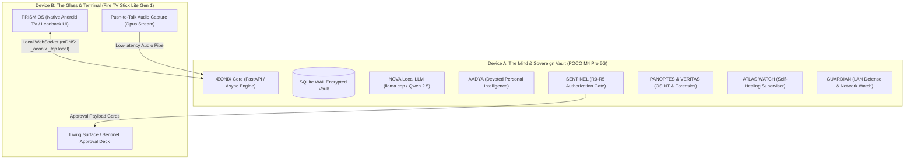
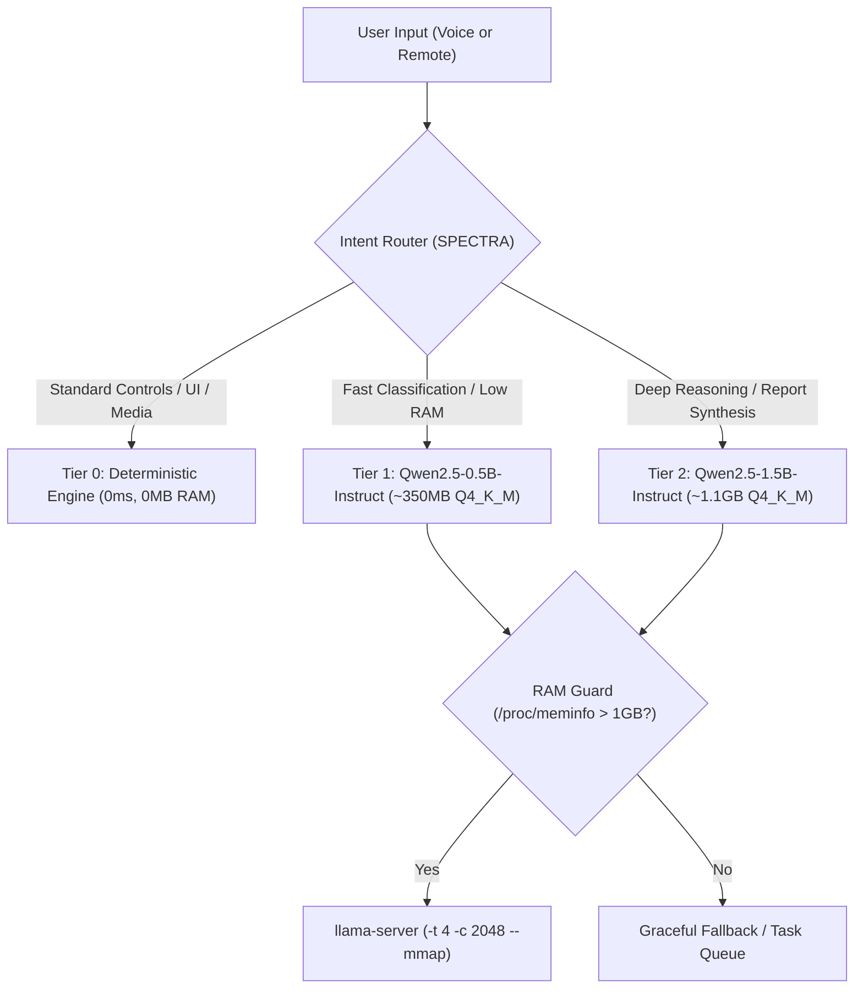
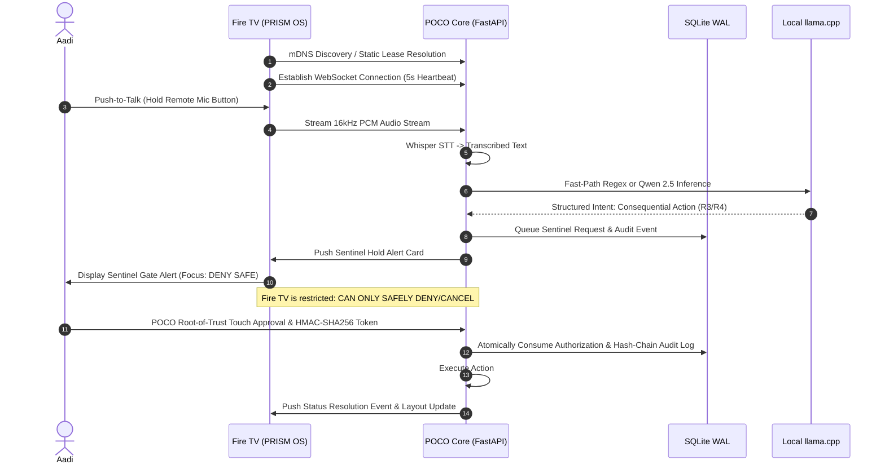

# ÆONIX PRISM — Deep Architecture & System Analysis

> **Aadi’s Sovereign Personal Intelligence Environment & Living-Room OS**  
> *Consolidated Analysis of Master Blueprints, Coding Guidelines v2.0, Agent Registries, and Implementation Plans.*

---

## 1. Executive Summary & Master Identity

**ÆONIX PRISM** represents the unified culmination of multiple design iterations (**AURA** $\rightarrow$ **KAIROS** $\rightarrow$ **OMNIA** $\rightarrow$ **NOEMA** $\rightarrow$ **ÆTHERION** $\rightarrow$ **ÆONIX PRISM**). It is a private, sovereign, local-first intelligence operating system built for **Aadi**, designed to run completely free of commercial subscriptions, cloud lock-in, or centralized censorship.



### Core Design Philosophy
1. **Total Sovereignty & Privacy:** All personal data, memories, investigative cases, and evidence remain physically stored on local hardware.
2. **Zero-Cost & Pure Local LLM Execution (Directive v2.0):** No dependency on paid APIs, cloud LLM tokens, or quota-limited commercial free tiers (no OpenAI, Gemini, or Groq API keys required). Local open-weight GGUF models run on-device.
3. **The Human Authority (Sentinel):** The agent never performs autonomous consequential actions (deletions, network scans, file exports). Everything requires explicit human approval via cryptographic payload cards.
4. **Extreme Hardware Realism:** The software is designed from the ground up to respect the tight thermal, memory, and OS limits of a mobile phone and a streaming stick.

---

## 2. Absolute Hardware Constraints (The "Two-Device Rule")

The architecture strictly rejects imaginary servers, cloud VMs, or laptop dependencies. The entire system is engineered for two specific physical devices:

| Dimension | **Device A: The Mind (POCO M4 Pro 5G)** | **Device B: The Glass (Fire TV Stick Lite Gen 1)** |
| :--- | :--- | :--- |
| **SoC & Compute** | MediaTek Dimensity 810 (8-core), up to 8GB RAM | MediaTek MT8695D Quad-Core, **1GB Total RAM** |
| **Operating System** | Android 12/13/HyperOS with **Termux** environment | Fire OS 7 (Android 9, API 28) |
| **Assigned Role** | Sovereign Core, Database, Agent Orchestrator, LLM Inference | Thin Client, Cinematic UI, Remote/PTT Input |
| **OS Threats** | • Android Out-Of-Memory (OOM) Killer<br>• Phantom Process Killer (max 32 child processes)<br>• Wi-Fi DTIM sleep / network drops | • Fire OS background process termination<br>• Garbage Collection pauses / UI frame drops<br>• Strict RAM pressure (~350MB usable after OS) |
| **Engineering Mandates** | • `termux-wake-lock` active, unrestricted battery<br>• Single-worker async FastAPI backend<br>• Child process count strictly kept $< 16$<br>• SQLite WAL mode with graceful SIGINT/SIGTERM | • **Zero inference, zero scraping, zero heavy DB**<br>• Memory ceiling $< 180\text{MB}$ RAM, APK $< 100\text{MB}$<br>• Native Kotlin Leanback (no heavy WebViews or 3D)<br>• **Push-to-Talk only** (no continuous hotword listening) |

---

## 3. Local LLM & Keyless Intelligence Strategy

To ensure 100% lifetime autonomy without ongoing costs, the system utilizes a tiered model routing hierarchy:



### The llama-server Execution Profile
* **Binary:** Native ARM64 `llama.cpp` compiled inside Termux.
* **Flag Hardening:**
  ```bash
  ./llama-server -m qwen2.5-1.5b-instruct-q4_k_m.gguf \
      --host 127.0.0.1 --port 8081 \
      -c 2048 \
      -t 4 \
      --mmap \
      --mlock false
  ```
  * `-t 4`: Restricts execution to 4 performance cores, avoiding CPU saturation and thermal throttling.
  * `-c 2048`: Hard limit on context window to bound KV-cache memory usage.
  * `--mmap`: Page mapping from internal UFS storage to prevent physical memory exhaustion.
* **Pre-Inference RAM Guard:** Inspects `/proc/meminfo` before every inference run. If free RAM $< 1\text{GB}$, inference is rejected or deferred to protect Termux from Android's OOM killer.
* **Keyless External Integrations:**
  * **Weather:** Open-Meteo API (100% free, keyless JSON endpoint).
  * **Public Intel & Search:** DuckDuckGo HTML / Wikipedia API / Open RSS.
  * **STT (Speech-to-Text):** Local `whisper.cpp` (`tiny.en` quantized GGUF) or `sherpa-onnx` on POCO.
  * **TTS (Text-to-Speech):** Native Android TTS or lightweight local Piper TTS.

---

## 4. Master Agent & Subsystem Matrix

ÆONIX PRISM divides capabilities into specialized, decoupled agents coordinated via LangGraph on the POCO:

### 1. AADYA — Aadi’s Eternal Intelligence
* **Identity:** Solely devoted to Aadi. Thinks, remembers, plans, and protects exclusively for Aadi’s benefit.
* **Core Modules:**
  * **Aadi-First Priority Engine:** Evaluates every task against: *"Does this improve Aadi's life, future, safety, or freedom?"*
  * **Future Radar:** Scans for career opportunities, skill gaps, income paths, project ideas, and security/financial risks.
  * **Protection Instinct:** Proactively alerts to burnout, digital privacy leaks, suspicious interactions, and deadline risks.
  * **Memory Heart:** Persistent long-term recall of goals, promises, personal preferences, and past decisions.
* **Ethics Boundary:** Deeply devoted and protective, but never manipulative or possessive. Respects Aadi's complete authority.

### 2. NOVA — The Offline Mind & Direct Execution Layer
* Operates locally when completely air-gapped or disconnected from the internet.
* **Direct Model Mode:** No arbitrary moralizing or silent rewriting layer. Once verified by Sentinel and signed by Aadi, NOVA executes directly with approved local tools.

### 3. SENTINEL — The Sovereign Gatekeeper
* Non-negotiable authorization layer for any consequential action.
* **Risk Tiers:** $R_0$ (Safe/Read-only) through $R_5$ (High Risk: File deletion, LAN scanning, credential/ADB access).
* Pushes structured **Interactive Payload Cards** to the POCO screen and Fire TV UI. Actions resume *only* upon physical confirmation.
* **Audit Trail:** Append-only SQLite table with SHA-256 cryptographic hash chaining (`previous_hash` $\rightarrow$ `current_hash`).

### 4. PANOPTES — Lawful OSINT & Investigation Suite
* Built for security researchers and legal professionals.
* **Subject Intelligence (IDENTITY):** Lawful public-surface profiling (public records, archives, certificates, DNS, professional footprints). Strictly forbids non-consensual surveillance or illicit databases.
* **SpiderFoot Bridge:** Public domain, IP, ASN, subdomain, and tech-stack mapping.
* **God's Eye Bridge:** Authorized security posture checks (authorized subdomain enumeration, open port verification, cloud misconfiguration checks).
* **Nexus Entity Graph:** Maps correlations: $\text{Person} \leftrightarrow \text{Username} \leftrightarrow \text{Email} \leftrightarrow \text{Domain} \leftrightarrow \text{IP} \leftrightarrow \text{Service}$.

### 5. VERITAS — Forensic Evidence Engine
* **Detective Mode:** Analyzes complex multi-source evidence, creating interactive timelines, correlation graphs, and competing hypothesis testing.
* **Chain of Custody:** Calculates SHA-256 hashes immediately upon evidence ingestion. Original evidence files are marked immutable; all analysis occurs on working copies.

### 6. GUARDIAN & ATLAS WATCH — Defense & Self-Healing
* **GUARDIAN:** Passive and active LAN device discovery, unknown device alerts, ARP spoofing detection.
* **ATLAS WATCH:** 24/7 supervisor monitoring phone thermals, RAM pressure, zombie processes, and Fire TV connection health.
  * **Level 1 (Safe Auto-repair):** Trims bounded caches, restarts non-critical endpoints, drops context window.
  * **Level 2 (Approved Repair):** Proposes backend service restart or index rebuild.
  * **Level 3 (Sanctuary Lockdown):** Emergency pause of all active missions and termination of external connections.

---

## 5. Network & Data Architecture



### SQLite Hardening & Disaster Recovery Architecture
Termux processes can be killed abruptly if the mobile OS reclaims memory. While standard SQLite WAL mode cannot mathematically guarantee "zero corruption" under violent kernel panics, the database is hardened with industry-standard resilience safeguards:
```sql
PRAGMA journal_mode = WAL;
PRAGMA synchronous = NORMAL;
PRAGMA temp_store = MEMORY;
PRAGMA busy_timeout = 5000;
PRAGMA integrity_check;
```
* **Active Database:** Unencrypted on local internal storage for raw read/write throughput on Dimensity 810.
* **Encrypted Cold Vault:** Atomic online snapshot archives (`.enc`) are encrypted using **AES-256-GCM** with PBKDF2 key derivation and SHA-256 checksum verification before storage or export.

### Reconciled Architecture & Transport Specifications (v2.1 Revision Note)
* **Approval Authority:** Supersedes earlier TV-approval drafts. The Fire TV Glass terminal is strictly restricted to **DENY / CANCEL (SAFE)**. Consequential approvals require cryptographic signing on the **POCO Core Mind**.
* **Voice Transport:** Fire TV streams **raw 16-bit 16kHz Mono PCM** over WebSocket directly to the POCO Core, eliminating client-side Opus compression/decompression latency on the quad-core MT8695D.
* **Agent Orchestrator:** Supersedes heavyweight LangGraph dependencies. Coordinated via a single-worker async event loop with heavy executor thread pools to stay strictly below Android's 32 phantom process limit.
* **Versioned Memory Budgets (Fire TV):**
  * **Target Baseline (Ambient / Screensaver):** $< 80\text{MB}$ active PSS.
  * **Peak Ceiling (Full Cinematic Leanback / Media Browsing):** $< 180\text{MB}$ total PSS.
  * **Hard Constraint:** 0 WebViews, native Leanback Views only.

---

## 6. Phased Implementation Roadmap

To avoid monolithic scope creep, the blueprint defines a strict 3-phase engineering pipeline:

```mermaid
flowchart LR
    subgraph P1 ["Phase 1: The Core Loop"]
        direction TB
        F1["POCO FastAPI Daemon"]
        F2["SQLite WAL Database"]
        F3["Fire TV Leanback Shell"]
        F4["mDNS & WebSocket Pipe"]
    end

    subgraph P2 ["Phase 2: Intelligence & Sentinel"]
        direction TB
        I1["Push-to-Talk Opus Pipeline"]
        I2["llama.cpp Local Runtime"]
        I3["Sentinel Approval Cards"]
        I4["AADYA Core Persona & Memory"]
    end

    subgraph P3 ["Phase 3: Deep Security & Forensics"]
        direction TB
        S1["PANOPTES OSINT Engine"]
        S2["VERITAS Forensic Timeline"]
        S3["GUARDIAN LAN Defense"]
        S4["ATLAS Self-Healing Daemon"]
    end

    P1 --> P2 --> P3
```



1. **Phase 1: The Core Loop (Foundation)**
   * Deploy the lightweight async FastAPI backend on POCO (Termux).
   * Initialize SQLite tables with WAL mode, SHA-256 audit chaining, and integrity checks.
   * Build the minimal Android TV Leanback app for Fire TV Stick Lite with mDNS discovery.
   * Establish persistent bidirectional WebSockets for layout state streaming.

2. **Phase 2: Intelligence & Human Authority (Brain & Voice)**
   * Integrate Push-to-Talk (PTT) audio streaming from Fire TV to POCO.
   * Compile and calibrate `llama.cpp` with the RAM guard and Qwen2.5 GGUF models.
   * Implement the Sentinel approval deck on the TV screen and phone interface.
   * Deploy AADYA’s foundational persona, memory heart, and goal tracker.

3. **Phase 3: Investigation, Security & Resilience (The Arsenal)**
   * Build the PANOPTES OSINT correlation pipeline and Nexus Entity Graph.
   * Deploy VERITAS forensic evidence hashing, chain-of-custody tracking, and case reporting.
   * Activate GUARDIAN local network intrusion detection.
   * Implement ATLAS WATCH watchdog loops for thermal and memory management.

---

## 7. Immediate Readiness Assessment

* **Current Environment:** Termux running directly on your POCO device (`/data/data/com.termux/files/home`).
* **Existing Project Assets:** Earlier experiments in `/data/data/com.termux/files/home/cleanyourtv` and APK tools indicate you already have the Android toolchain, ADB connections, and Termux environment ready to go.
* **Next Practical Step:** Begin **Phase 1: The Core Loop**, setting up the hardened FastAPI daemon and the minimal Fire TV Leanback client.
