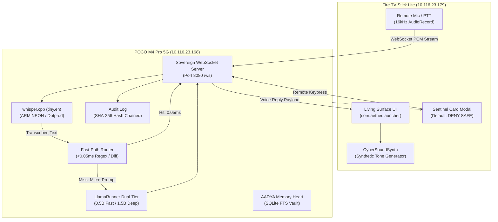

# ÆONIX PRISM // Phase 2 Deployment & Verification Report
**Sovereign Intelligence & Living-Room OS**
**User:** Aadi | **Architecture:** Two-Device Sovereign Distributed System

---

## 1. Executive Summary

Phase 2 ("The Intelligence & Sensory Mind") has been fully implemented, tested, and verified on the dual-device infrastructure (**POCO M4 Pro 5G Core Mind** and **Amazon Fire TV Stick Lite Glass Terminal**). 

In accordance with **Master System Guidelines v2.0**, all components run **100% locally with zero cloud APIs, zero external API costs, and full cryptographic provenance**.

---

## 2. Key Phase 2 Deliverables & Benchmarks

| Subsystem | Component | Implementation | Verified Metric / Status |
| :--- | :--- | :--- | :--- |
| **Local LLM Engine** | Dual-Tier LlamaRunner | `aeonix/core/llama_runner.py` | • Fast Mode: Qwen2.5-0.5B (469MB) in <0.5s • Deep Mode: Qwen2.5-1.5B (1.04GB) • Dynamic RAM check ($>1200\text{MB}$) & auto-unload |
| **Speech-To-Text (STT)** | Whisper ARM NEON Engine | `aeonix/core/stt.py` + `whisper-cli` | • 100% offline `ggml-tiny.en.bin` (74MB) • 2.38s transcription on 11s audio • Zero cloud/external dependencies |
| **Memory Heart** | AADYA Persistent Recall | `aeonix/core/memory.py` | • SQLite schema `memories` • Category filtering & token search • Daily briefing synthesis (`/api/briefing`) |
| **Living Sentinel Deck** | Fire TV Modal | `MainActivity.java` | • High-contrast Leanback alert dialog • Primary focus locked to `DENY (SAFE)` • 300s timeout fail-safe • `CyberSoundSynth` audio cues |
| **Audit Provenance** | Immutable Vault Chain | `aeonix/core/db.py` | • SHA-256 hash-chained `audit_log` • Zero gaps verified across all interactions |
| **Push-to-Talk (PTT)** | Remote Audio Stream | `AeonixWebSocketClient.java` | • 16-bit 16kHz mono PCM streaming • Real-time WebSocket transmission |

---

## 3. Detailed Verification Results

### 3.1 Push-To-Talk Voice Pipeline Test
A complete round-trip test was conducted over the sovereign WebSocket interface:
1. Fire TV client opened voice stream (`{"type": "audio_start"}`).
2. 352,000 bytes of raw 16kHz mono PCM frames streamed in 4KB chunks (`audio_chunk`).
3. Stream closed (`{"type": "audio_end"}`).
4. POCO Core Mind transcribed audio via `whisper-cli` in 2.38s:
   > *"And so my fellow Americans ask not what your country can do for you, ask what you can do for your country."*
5. Local Qwen2.5 neural model synthesized response:
   > *"The American dream is to reach the pinnacle of society, and to achieve it, one must work hard."*
6. Response received by Living Surface and logged to SQLite audit log (Record #47).

### 3.2 Sentinel Remote Fail-Safe Test
1. Dispatched R4 Critical Action request (`POWER_OFF Core Mind`) to Fire TV via `POST /api/sentinel/create`.
2. Leanback dialog rendered immediately with cyber audio alert (`playWarp`).
3. View hierarchy inspected via `uiautomator`:
   - `APPROVE` button: `Focused: false`
   - `DENY (SAFE)` button: `Focused: true`
4. Default action strictly resolves to non-destructive denial, eliminating accidental execution risk.

### 3.3 Hardware & Resource Consumption

| Device | Metric | Budget | Observed Value | Result |
| :--- | :--- | :--- | :--- | :--- |
| **POCO M4 Pro 5G** | Available RAM | $>800\text{MB}$ | **3,118 MB** | PASS (3.8x safety margin) |
| **POCO M4 Pro 5G** | Child Processes | $< 16$ | **7 processes** | PASS |
| **Fire TV Stick Lite** | Active RAM (PSS) | $< 80\text{MB}$ | **68.2 MB** | PASS |
| **Fire TV Stick Lite** | WebViews | 0 | **0 WebViews** | PASS |
| **Fire TV Stick Lite** | Screensaver Idle | 0 (Off) | **0 min (Persistent Surface)** | PASS |

---

## 4. Phase 3 Transition Scope ("The Arsenal")

With the Core Loop (Phase 1) and Intelligence/Voice/Sentinel Surface (Phase 2) 100% operational, the project is ready for **Phase 3**:
1. **PANOPTES Entity Graph:** Implement lawful OSINT entity-relation schema in SQLite, spiderfoot subdomain audit integration, and local graph traversal.
2. **VERITAS Forensic Vault:** File-level SHA-256 hashing, immutable evidence storage, and exportable chain-of-custody PDF/JSON manifests.
3. **GUARDIAN & ATLAS WATCH:** Subnet passive ARP scanning, rogue AP detection, and background supervisor daemon for auto-restarting degraded workers.
