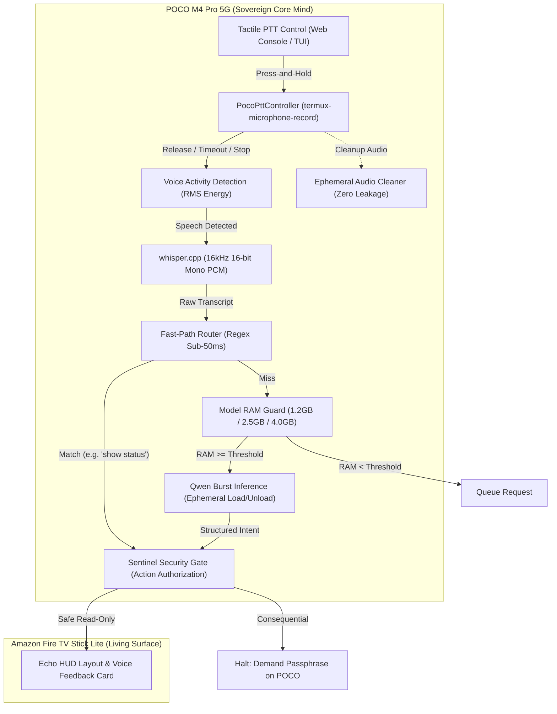

# P0-3: POCO Phone Microphone PTT Wiring and Latency Tuning Implementation Plan

> **For agentic workers:** REQUIRED SUB-SKILL: Use superpowers:subagent-driven-development (recommended) or superpowers:executing-plans to implement this plan task-by-task. Steps use checkbox (`- [ ]`) syntax for tracking.

**Document ID:** `AEONIX-PLAN-P0-3-POCO-MIC-PTT`  
**Branch:** `feature/p0-3-poco-microphone-ptt`  
**Target Milestone:** Post-RC-1.1 / Milestone P0 Stabilization  
**Prerequisites:** RC-1.1 baseline (`99186c8`), `whisper.cpp` (`ggml-tiny.bin`), `llama-server` / Qwen2.5-0.5B / 1.5B  

---

## 1. System Architecture & Component Responsibilities

The goal of Ticket P0-3 is to wire physical microphone Push-to-Talk (PTT) capabilities on the sovereign POCO M4 Pro 5G handset, achieving low-latency voice command recognition and dispatch without introducing any background listening, cloud dependencies, or unverified Fire TV remote audio capture.

### File Structure:
- `aeonix/core/ptt.py`: POCO Push-to-Talk recording lifecycle controller (wraps `termux-microphone-record`, handles instant aborts on release/timeout/background/lockdown/denial/cancel).
- `aeonix/core/ram_guard.py`: Updated model-specific dynamic RAM guard thresholds (0.5B: >=1.2GB, 1.5B: >=2.5GB, 3B: >=4.0GB).
- `aeonix/core/model_queue.py`: Bounded priority queue manager for AI inference requests when available RAM is below threshold.
- `aeonix/core/voice_pipeline.py`: End-to-end voice intent pipeline connecting PTT audio, VAD, STT, Fast-Path, RAM-guarded burst inference, and Sentinel gating.
- `aeonix/ui/ptt_console.py`: POCO operator interface delivering tactile PTT button, recording duration timer, waveform/VAD feedback, and status badges.
- `tests/test_p0_3_poco_mic_ptt.py`: Exhaustive unit and integration test suite covering all 13 required test cases.
- `scripts/benchmark_p0_3_voice_latency.py`: Automated physical latency and resource profiler.

---

## 2. Implementation Tasks

### Task 1: Model-Specific Dynamic RAM Guard & Queue Manager
**Deliverables:** Update `aeonix/core/ram_guard.py` and implement `aeonix/core/model_queue.py`.

- [ ] **Step 1.1**: Write failing unit tests in `tests/test_ram_guard_thresholds.py` verifying model-specific RAM constraints:
  - 0.5B requires >= 1.2 GB (1,228,800 KB) free RAM.
  - 1.5B requires >= 2.5 GB (2,560,000 KB) free RAM.
  - 3B requires >= 4.0 GB (4,096,000 KB) free RAM.
  - Request queuing when RAM is insufficient.
- [ ] **Step 1.2**: Run tests to confirm failure.
- [ ] **Step 1.3**: Update `aeonix/core/ram_guard.py` with `MODEL_RAM_THRESHOLDS_KB = {"0.5B": 1200000, "1.5B": 2500000, "3B": 4000000}` and `check_model_ram_guard(model_size: str) -> Dict[str, Any]`.
- [ ] **Step 1.4**: Implement `aeonix/core/model_queue.py` providing `ModelQueueManager` with queue capacity bounding (max 5 items), TTL expiration (30s), and automatic dequeuing when RAM recovers.
- [ ] **Step 1.5**: Re-run tests and confirm 100% pass.
- [ ] **Step 1.6**: Commit changes: `git commit -m "feat(ram-guard): implement model-specific dynamic thresholds and queue manager"`.

---

### Task 2: POCO Push-to-Talk Lifecycle Controller (`aeonix/core/ptt.py`)
**Deliverables:** Implement `PocoPttController` managing `termux-microphone-record` with strict hardware-release guarantees.

- [ ] **Step 2.1**: Write failing unit tests in `tests/test_poco_ptt_controller.py`:
  - Normal recording start and stop on button release.
  - Hard timeout stop (configurable max seconds, default 10s, max 15s).
  - Immediate stop on app backgrounding / focus loss.
  - Immediate stop on Sentinel lockdown trigger.
  - Permission-denied graceful handling (mocked exit code / missing binary).
  - User cancellation (discards buffer and wipes file).
  - Ephemeral audio file cleanup (guarantee file deleted after buffer read).
- [ ] **Step 2.2**: Run tests to confirm failure.
- [ ] **Step 2.3**: Implement `PocoPttController` in `aeonix/core/ptt.py`:
  - Methods: `start_recording()`, `stop_recording() -> bytes`, `cancel()`, `on_background()`, `on_sentinel_lock()`.
  - Process management: runs `termux-microphone-record -f <tmp_file> -r 16000 -c 1 -l <max_seconds>` in child process.
  - Stop mechanism: executes `termux-microphone-record -q`, falls back to SIGTERM/SIGKILL if process remains active >100ms.
  - Reads captured 16kHz PCM/WAV bytes into memory, immediately unlinks temporary file from disk.
  - Graceful fallback / simulation mode when `termux-microphone-record` is absent or unprivileged.
- [ ] **Step 2.4**: Re-run tests and confirm 100% pass.
- [ ] **Step 2.5**: Commit changes: `git commit -m "feat(ptt): implement PocoPttController with lifecycle stops and audio cleanup"`.

---

### Task 3: Fast-Path First Voice Intent Pipeline & Sentinel Safety Gate
**Deliverables:** Implement `aeonix/core/voice_pipeline.py` integrating STT, Fast-Path regex, Qwen burst, and Sentinel gating.

- [ ] **Step 3.1**: Write failing unit tests in `tests/test_voice_intent_pipeline.py`:
  - Fast-Path match (e.g. "show system status", "dismiss alert", "what time is it") returns sub-50ms deterministic intent without touching LLM runner.
  - Fast-Path miss routes to local Qwen burst inference (checking RAM guard first).
  - Ephemeral model lifecycle: `llama_runner` loads model, computes completion, unloads model immediately.
  - Consequential voice command interception: Commands containing destructive or approval keywords ("approve mission", "delete vault", "restart core") produce `SENTINEL_VOICE_BLOCKED` and demand physical passphrase entry on POCO.
  - Audio retention test: verifies zero persistent raw audio files retained after transcription.
- [ ] **Step 3.2**: Run tests to confirm failure.
- [ ] **Step 3.3**: Implement `aeonix/core/voice_pipeline.py` with `process_voice_audio(audio_bytes: bytes, actor: str) -> Dict[str, Any]`.
  - Step A: Voice Activity Detection (RMS energy check). If silent, return `SILENCE_REJECTED`.
  - Step B: Offline Whisper STT via `whisper.cpp` (`transcribe_pcm`).
  - Step C: Fast-Path regex evaluation (`match_fast_path`). If matched, execute deterministically.
  - Step D: If Fast-Path misses, check `check_model_ram_guard("0.5B")`. If safe, spawn burst inference via `llama_runner`, extract structured intent, and immediately call `llama_runner.stop_server()`.
  - Step E: Sentinel policy evaluation (`evaluate_voice_security_boundary`). If action is consequential, enforce `DENIED_VOICE_AUTHORIZATION` and broadcast notice to Living Surface.
  - Step F: Return intent and broadcast `voice_feedback` card to Fire TV Living Surface.
- [ ] **Step 3.4**: Re-run tests and confirm 100% pass.
- [ ] **Step 3.5**: Commit changes: `git commit -m "feat(pipeline): implement Fast-Path first voice pipeline with ephemeral burst LLM and Sentinel gate"`.

---

### Task 4: POCO Tactile PTT Operator Interface
**Deliverables:** Implement `aeonix/ui/ptt_console.py` and mount endpoint in `aeonix/core/server.py`.

- [ ] **Step 4.1**: Implement a lightweight mobile-optimized HTML/JS tactile PTT touch widget:
  - Large tactile button (`PRESS & HOLD TO SPEAK`).
  - Event listeners: `touchstart`/`mousedown` triggers `/api/voice/ptt/start`; `touchend`/`mouseup` triggers `/api/voice/ptt/stop`.
  - `visibilitychange` / `blur` triggers `/api/voice/ptt/cancel` (background stop).
  - Live pulsing red recording indicator with timer countdown.
  - Real-time status display showing transcription, route (`FAST-PATH` vs `ORACLE`), and Sentinel status.
- [ ] **Step 4.2**: Register HTTP endpoints in `aeonix/core/server.py`:
  - `POST /api/voice/ptt/start`: Arms and starts `PocoPttController`.
  - `POST /api/voice/ptt/stop`: Stops recording, retrieves audio, triggers pipeline, returns result.
  - `POST /api/voice/ptt/cancel`: Discards audio immediately.
  - `GET /api/voice/ptt/status`: Returns current state (`IDLE`, `RECORDING`, `PROCESSING`).
- [ ] **Step 4.3**: Write unit test verifying endpoints in `tests/test_ptt_endpoints.py`.
- [ ] **Step 4.4**: Re-run tests and confirm 100% pass.
- [ ] **Step 4.5**: Commit changes: `git commit -m "feat(ui): add POCO tactile PTT operator console and server endpoints"`.

---

### Task 5: Master Integration Test Suite (`tests/test_p0_3_poco_mic_ptt.py`)
**Deliverables:** Master test file covering all 13 user-specified test requirements.

- [ ] **Step 5.1**: Implement `tests/test_p0_3_poco_mic_ptt.py` asserting:
  1. `test_01_permission_denied`: Graceful error returned, zero crash.
  2. `test_02_ptt_start_and_normal_stop`: Full record-to-stop lifecycle.
  3. `test_03_timeout_stop`: Hard cutoff at 15.0s ceiling.
  4. `test_04_background_app_switch_stop`: Immediate hardware mic release on blur.
  5. `test_05_sentinel_lockdown_stop`: Security lock halts active recording.
  6. `test_06_network_interruption`: Local processing succeeds even if TV WebSocket drops.
  7. `test_07_stt_failure_and_silence`: VAD rejects silent PCM buffers without wasting cycles.
  8. `test_08_fast_path_routing`: Sub-50ms execution on regex commands.
  9. `test_09_llm_fallback_routing`: Unmatched query routes to local Qwen.
  10. `test_10_ram_guard_queueing`: Requests queued when available RAM < threshold.
  11. `test_11_model_load_and_unload_lifecycle`: Model process active only during burst.
  12. `test_12_zero_audio_retention`: Zero audio artifacts remain in `/tmp` or database.
  13. `test_13_sentinel_gating_consequential_commands`: Voice approvals blocked fail-closed.
- [ ] **Step 5.2**: Run full portable test suite (existing 199 tests + new P0-3 tests). Confirm 100% pass.
- [ ] **Step 5.3**: Commit changes: `git commit -m "test(p0-3): verify complete 13-case POCO microphone PTT test suite"`.

---

### Task 6: Physical Hardware Latency & Resource Profiler
**Deliverables:** Create `scripts/benchmark_p0_3_voice_latency.py` and run controlled validation.

- [ ] **Step 6.1**: Implement `scripts/benchmark_p0_3_voice_latency.py` measuring:
  - PTT start-to-record latency (ms).
  - VAD calculation latency (ms).
  - Whisper STT transcription latency (ms).
  - Fast-Path regex matching latency (ms).
  - Local Qwen burst inference latency (ms).
  - Total end-to-end latency (ms).
  - RAM consumption before, during, and after inference (MB).
  - CPU thermal delta and child process count.
- [ ] **Step 6.2**: Execute controlled benchmark runs across both synthetic and physical audio inputs.
- [ ] **Step 6.3**: Compile benchmark findings into `docs/evidence/p0_3_voice_latency_report.md`.
- [ ] **Step 6.4**: Commit changes: `git commit -m "docs(evidence): record P0-3 physical voice latency and resource profile"`.

---

## 3. Strict Safety & Invariant Checklist

Before requesting review:
- [ ] No cloud network requests made during any audio capture or processing.
- [ ] No continuous background recording or listening daemons running.
- [ ] No Fire TV remote audio capture dependencies introduced.
- [ ] Free RAM guard strictly enforced: 1.2GB (0.5B), 2.5GB (1.5B), 4.0GB (3B).
- [ ] Model unloaded immediately after burst inference.
- [ ] All temporary audio files unlinked immediately.
- [ ] Sentinel Gate strictly blocks voice authorization for consequential actions.
- [ ] 199 existing tests remain passing with zero regressions.
